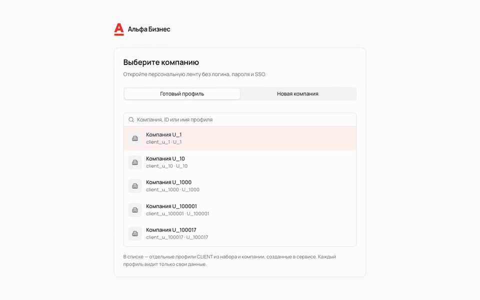
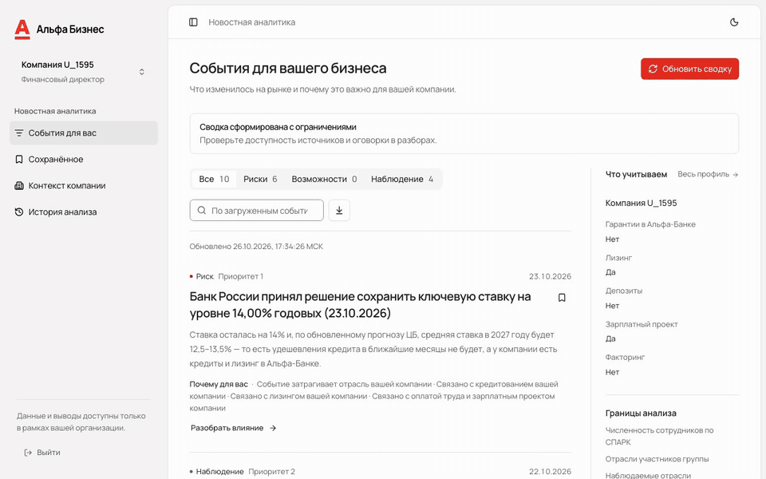
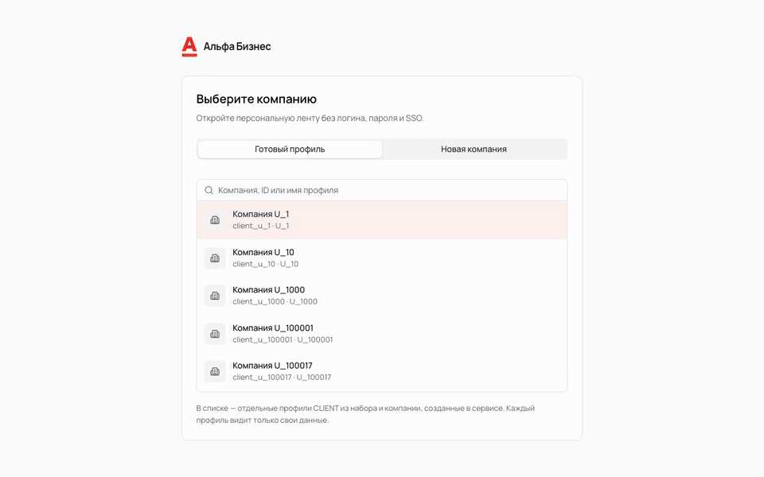
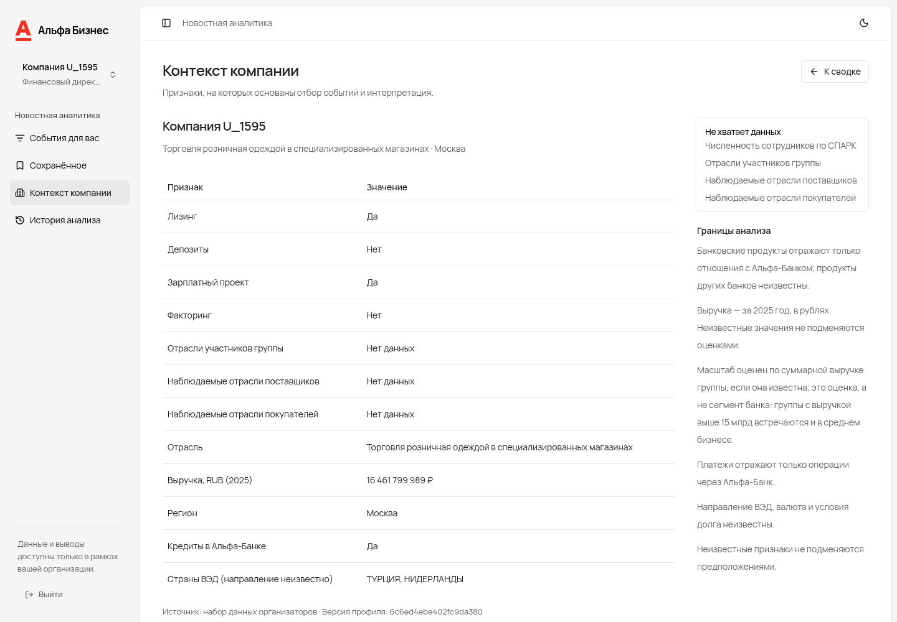
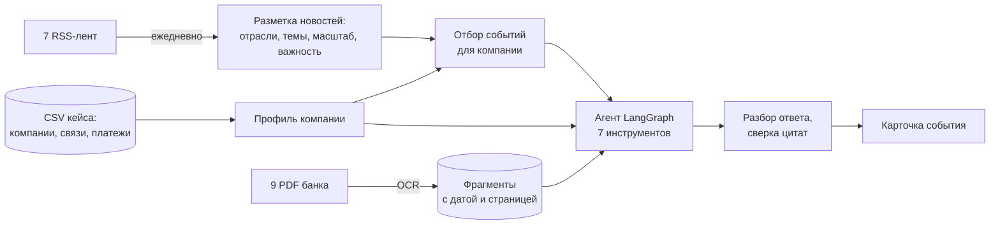
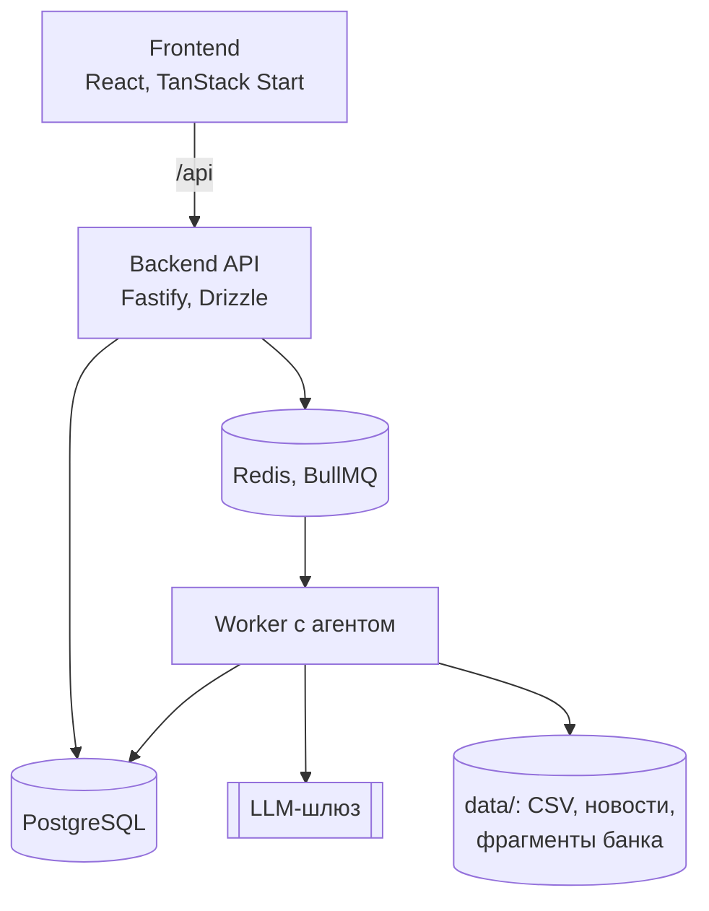

# Альфа Контекст

Сервис персональной новостной аналитики для руководителей крупных компаний. Он выбирает из потока новостей события, которые касаются конкретной компании, объясняет возможные последствия для CFO или CEO и показывает, на чём основан каждый вывод.

Демо: [alfa.niik.me](https://alfa.niik.me). Вход без пароля, достаточно выбрать компанию.

[](https://github.com/al5-alfa-hackaton/alfa-hack-2026/actions/workflows/ci.yaml)


Содержание: [задача](#задача) · [проверка сценария](#как-проверить) · [как устроено решение](#как-устроено-решение) · [качество](#качество) · [запуск](#запуск) · [масштабирование](#масштабирование) · [ограничения](#ограничения)

## Задача

Руководителю крупной компании важна не новость сама по себе, а то, как она влияет на его бизнес. Поэтому мы решаем несколько конкретных проблем:

- общая лента длинная, а важных событий в ней немного: мы отбираем события по отрасли, региону, группе компаний, контрагентам, продуктам банка и внешней торговле конкретной компании;
- CFO и CEO смотрят на одно событие по-разному: для каждой роли свой порядок событий и свой текст;
- выводам ИИ трудно доверять: факт, позиция банка и вывод ИИ показаны раздельно, у факта всегда есть дословная цитата;
- непонятно, откуда взялся вывод: у каждой карточки видны причины отбора, источники и шаги агента;
- анализ считается десятки секунд: он идёт в фоновой очереди и не теряется при закрытии страницы.

Данные кейса: 41 968 компаний-клиентов (85 525 строк вместе с контрагентами), около двух тысяч новостей из 7 RSS-лент с ежедневным обновлением, 9 материалов банка (64 страницы сканов, 212 фрагментов с датой и страницей).

## Как проверить

1. Откройте демо и введите в поиск `U_1595` (или название компании). Выберите компанию. Каждый пользователь видит только свою компанию.

   

2. В ленте переключите ракурс CFO и CEO. Порядок событий и объяснения «Почему для вас» поменяются.

   

3. Откройте карточку. В ней отдельно: что произошло (цитата), позиция банка (цитата из материала банка с датой), выводы ИИ с оговорками, риски, возможности и следующий шаг. Вкладка «Источники» ведёт к цитате в первоисточнике, во вкладке «Ход анализа» виден журнал шагов агента.

   

4. Задайте агенту вопрос по карточке, например «В двух предложениях» или «Что с нашими кредитами?». Если данных не хватает, агент задаёт уточняющий вопрос, а не придумывает ответ.
5. Во вкладке «Новая компания» задайте свои отрасль, регион, выручку, продукты и страны торговли. Неизвестные поля остаются пустыми и не заменяются нулями. Лента перестроится под новую компанию.

   

Дополнительно: «Обновить новости» запускает новый анализ, события можно сохранять, оценивать и комментировать, искать по тексту (`Ctrl/⌘ + K`), выгружать в TXT и открывать по ссылке `?insight=<UUID>`. Есть журнал шагов агента, тёмная тема и мобильная вёрстка.

Страница профиля компании:

[](docs/screenshots/company-desktop.png)

## Как устроено решение



### Что можно доверять в карточке

| Тип           | Источник              | Правило                                                                                           |
| ------------- | --------------------- | ------------------------------------------------------------------------------------------------- |
| Факт          | новость или материал  | публикуется только с дословной цитатой, найденной в документе                                     |
| Позиция банка | материалы Альфа-Банка | только цитата из материала банка, берётся самая свежая, с датой; устаревший прогноз отбрасывается |
| Вывод ИИ      | модель                | привязан к признакам компании, с оговоркой, никогда не выдаётся за позицию банка                  |

Цитаты проверяет обычный код, а не вторая модель: при пересборке текста модель могла незаметно изменить кавычки, и проверка фактов отбрасывала бы карточку.

### Отбор событий

Новости размечает модель: группы ОКВЭД, темы (ставка, кредит, курс, торговля, спрос и другие), масштаб и важность. Дальше событие сопоставляется с профилем компании:

```text
score = 0,65 × связь × важность + 0,15 × ракурс + 0,15 × свежесть + 0,05 × источник
```

| Связь компании с событием                                             | Вес                  |
| --------------------------------------------------------------------- | -------------------- |
| своя отрасль (группа ОКВЭД)                                           | 0,7                  |
| отрасли группы компаний, поставщиков и покупателей (по доле платежей) | до 0,4               |
| кредиты, лизинг, факторинг, гарантии                                  | 0,5, 0,35, 0,25, 0,2 |
| внешняя торговля                                                      | 0,4                  |
| зарплатный проект                                                     | 0,3                  |

Одно событие из нескольких источников попадает в ленту одной карточкой. Для каждой карточки хранятся до трёх причин отбора со ссылкой на признак профиля. Подробности и обоснование весов: [packages/agent/README.md](packages/agent/README.md#отбор-событий).

### Агент

Граф собран на LangGraph вручную. Модель сама выбирает инструменты и добирает данные, а после лимита шагов отвечает по тому, что собрано.

| Инструмент               | Назначение                                                          |
| ------------------------ | ------------------------------------------------------------------- |
| `company_profile`        | отрасль, выручка, продукты банка, внешняя торговля, пропуски данных |
| `company_group`          | группа компаний и связи через общих владельцев                      |
| `company_counterparties` | поставщики, покупатели, концентрация, их отрасли                    |
| `news_search`            | поиск по новостям (BM25 со стеммингом)                              |
| `bank_search`            | поиск по материалам банка с датой и страницей                       |
| `document_read`          | текст новости или страницы материала банка                          |
| `evidence_verify`        | проверка, что цитата есть в документе дословно                      |

ID компании подставляет сервер, у инструментов нет такого параметра, поэтому агент не может запросить чужую компанию. Каждый вызов записывается в журнал и виден в интерфейсе.

### Архитектура



- Frontend: React 19, TanStack Start/Router/Query, shadcn/ui, Tailwind 4, типизированный клиент из OpenAPI.
- Backend: Fastify, Zod, Drizzle, PostgreSQL, Redis и BullMQ. Модули разделены на domain, application, infrastructure и presentation. Доступ к данным ограничен компанией пользователя на каждом запросе.
- Агент (`packages/agent`): LangGraph, BM25, инструменты, разбор ответа, checkpoints в PostgreSQL.
- Запуски идемпотентны, восстанавливаются после падения worker, их можно отменить. Дневной бюджет на LLM резервируется до запуска.
- Схема OpenAPI генерируется из кода, CI проверяет, что она не разошлась с кодом. Границы слоёв и циклы импортов тоже проверяются автоматически.

## Качество

Измеряем на размеченных наборах новостей и вопросов. Компании новых отраслей (отложенная выборка) в настройке не участвовали.

| Что проверяем                                                              | Результат                         |
| -------------------------------------------------------------------------- | --------------------------------- |
| Точность цитат                                                             | 98–100%                           |
| Выдуманные числа в выводах                                                 | 0                                 |
| Вывод ИИ выдан за позицию банка                                            | 0                                 |
| P@3 (доля связанных с компанией новостей среди первых трёх), новые отрасли | 75% против 19% у отбора по словам |
| nDCG@5, новые отрасли                                                      | 0,73 против 0,17                  |
| Карточки с риском или возможностью и шагом                                 | 81%, на новых отраслях 100%       |
| Форма ответа на вопрос                                                     | 16 из 16                          |
| Время: лента из 10 событий / вопрос                                        | около 30 с / около 12 с           |
| Стоимость вопроса                                                          | около 0,25 ₽                      |

Модели из списка кейса: DeepSeek-V4.1-Flash для агента и разметки, Qwen3.6 35B A3B для распознавания сканов. Выбор сделан по сравнительным прогонам, отчёты лежат в [packages/agent/results](packages/agent/results/). Бюджет общего ключа 500 ₽ в день: сервис резервирует деньги на каждый запуск и не стартует, если лимиты настроены неверно.

Мониторинг: метрики, наборы оценки и процесс описаны в [docs/quality-monitoring.md](docs/quality-monitoring.md). Ежедневный отчёт по журналам Postgres собирает `pnpm monitor:report`, раз в неделю эксперт проверяет выборку карточек, оценки пользователей «полезно / не полезно» попадают в наборы оценки.

## Запуск

Данные кейса в репозиторий не входят (`data/raw` и `data/processed` в `.gitignore`). Скачайте их один раз:

```sh
python3 scripts/fetch-data.py
pnpm install --frozen-lockfile
pnpm --filter @alfa/agent build
pnpm --filter @alfa/agent ingest
```

### Docker Compose

```sh
docker compose --profile apps up --build
```

Откройте [http://localhost:3000](http://localhost:3000). Миграции и создание профилей клиентов выполняются отдельными задачами. Swagger: [http://localhost:3001/docs](http://localhost:3001/docs).

### Без контейнеров для приложения

Нужны Node.js 24.19 и pnpm 11.

```sh
cp projects/backend/.env.example projects/backend/.env
pnpm infra:up        # PostgreSQL и Redis
pnpm db:migrate
pnpm db:seed
pnpm dev             # frontend :3000, backend :3001
pnpm worker          # в отдельном терминале, нужен для новых разборов
```

### Свой сервер (Coolify)

В ресурсе укажите `Docker Compose Location = /compose.coolify.yaml`, положите `raw/` и `processed/` на сервер в `/data/alfa-hack` (или задайте `DATA_HOST_DIR`), для сервиса `frontend` укажите домен и порт 3000. Пароль базы и ключ сессии Coolify создаёт сам. В production нужен HTTPS.

### Генерация новых разборов

По умолчанию она выключена: без ключа LLM можно смотреть профили и уже готовые результаты. Чтобы включить, задайте в `projects/backend/.env` (или в переменных Coolify):

```env
AGENT_PROVIDER=langgraph
LLM_BASE_URL=https://<шлюз>/v1
LLM_API_KEY=<ключ>
LLM_GATEWAY_REQUEST_CAP_RUB=3
RUN_RESERVATION_RUB=45
```

`LLM_GATEWAY_REQUEST_CAP_RUB` указывайте только после того, как оператор шлюза подтвердил жёсткий лимит стоимости одного запроса. Резерв должен быть не меньше `CAP × (AGENT_MAX_STEPS + 2)`, а с `AGENT_VERIFY=true` на один шаг больше, иначе сервер не запустится. Затем перезапустите API и worker.

### Переменные окружения

| Переменная                                | По умолчанию                   | Назначение                                                                   |
| ----------------------------------------- | ------------------------------ | ---------------------------------------------------------------------------- |
| `NODE_ENV`                                | `development`                  | в `production` нужны HTTPS, `AUTH_SESSION_SECRET` и провайдер `langgraph`    |
| `DATABASE_URL`                            | нет                            | PostgreSQL                                                                   |
| `REDIS_URL`                               | `redis://127.0.0.1:6379`       | очередь заданий                                                              |
| `CORS_ORIGIN`                             | `http://localhost:3000`        | публичный адрес frontend                                                     |
| `AUTH_SESSION_SECRET`                     | создаётся `db:seed`            | подпись сессий, не короче 32 символов; в production задаётся явно            |
| `DATA_DIR`                                | `<repo>/data`                  | каталог с `raw/` и `processed/`                                              |
| `AGENT_PROVIDER`                          | `disabled`                     | `disabled`: только просмотр; `langgraph`: генерация; `fixture`: только тесты |
| `LLM_BASE_URL`, `LLM_API_KEY`             | нет                            | шлюз и ключ модели                                                           |
| `LLM_MODEL_AGENT`                         | `deepseek/deepseek-v4.1-flash` | модель из списка кейса                                                       |
| `LLM_GATEWAY_REQUEST_CAP_RUB`             | нет                            | подтверждённый предел стоимости запроса, ₽                                   |
| `DAILY_BUDGET_RUB`                        | `500`                          | дневной бюджет                                                               |
| `RUN_RESERVATION_RUB`                     | `25`                           | резерв бюджета на один запуск                                                |
| `AGENT_MAX_STEPS`, `AGENT_MAX_TOOL_CALLS` | `6`, `12`                      | лимиты шагов и вызовов инструментов                                          |
| `RANKING_LIMIT`                           | `10`                           | сколько событий агент разбирает за запуск, до 20                             |
| `FEED_CARDS`                              | нет                            | необязательный предел числа карточек, сначала с последствиями                |
| `AGENT_VERIFY`                            | `false`                        | дополнительная проверка выводов моделью (+1 вызов)                           |
| `NEWS_REFRESH_CRON`                       | нет                            | расписание ежедневного обновления новостей                                   |
| `RUN_TIMEOUT_MS`, `RUN_MAX_RECOVERIES`    | `180000`, `2`                  | таймаут запуска и число восстановлений                                       |

Полные списки: [projects/backend/.env.example](projects/backend/.env.example) и [packages/agent/.env.example](packages/agent/.env.example).

### Тестовые данные

Профили всех клиентов создаёт `pnpm db:seed`, вход без пароля. Для проверки подойдёт, например, `U_1595`. Новую компанию можно создать в интерфейсе. Автотесты используют изолированный режим `fixture` с синтетическими данными, в production он запрещён.

## Проверки

```sh
pnpm typecheck
pnpm test
pnpm build
pnpm contracts:check
RUN_INTEGRATION=true TEST_DATABASE_URL=postgresql://… pnpm test:integration
pnpm --filter @alfa/agent eval:ranking   # метрики отбора, бесплатно
pnpm --filter @alfa/agent eval:answers   # метрики ответов, около 9 ₽
```

[CI](.github/workflows/ci.yaml) на каждый коммит проверяет расхождение OpenAPI, архитектурные границы, unit- и интеграционные тесты на настоящих PostgreSQL, Redis и worker, 14 e2e-сценариев в Chromium (вход, регистрация, сохранения, вопросы, оценки, мобильная версия) и доступность через axe (WCAG 2 AA). Платные модели в тестах не вызываются.

## Масштабирование

| Задача                  | Как делается                                                                                                                      |
| ----------------------- | --------------------------------------------------------------------------------------------------------------------------------- |
| Новая отрасль           | Отрасли берутся из кодов ОКВЭД в данных; словарь разметки содержит 220 групп. Подгруппы добавляются без изменений в графе агента  |
| Новый источник новостей | Запись в списке источников (`packages/agent/src/data/news.ts`); полные тексты, очистка и разметка применяются автоматически       |
| Новые материалы банка   | PDF в каталог, запись в каталоге с датой и признаком актуальности, затем OCR и `ingest --bank`                                    |
| Новый тип клиента       | Признаки профиля заданы единым списком `FEATURE_IDS`, на него ссылаются промпты, разбор ответа и причины отбора                   |
| Нагрузка                | Анализ идёт в очереди, worker масштабируется горизонтально; расписание обновления выполняет один экземпляр                        |
| Контроль качества       | Любое изменение модели, промпта или отбора сравнивается с прошлым отчётом; найденные ошибки становятся новыми тестовыми примерами |

## Ограничения

- Вход без пароля сделан для демонстрации. Корпоративное SSO и управление доступом банка нужно подключать отдельно.
- Данные обезличены. Для контрагентов нет объёма долга и типа ставки, поэтому последствия для долга описываются условно.
- Позиция банка строится только на 9 переданных материалах. Если подходящего нет, интерфейс говорит об этом.
- Рекомендации оформлены как сценарии для рассмотрения. Сервис ничего не делает автоматически.

## Документация

[Продукт и требования](specs/01-product.md) · [Архитектура](specs/02-architecture.md) · [Данные](specs/03-data.md) · [Агент](specs/04-agent-runtime.md) · [API и UI](specs/05-api-and-ui.md) · [Ранжирование и checkpoints](specs/11-ranking-and-checkpoints.md) · [Аккаунты](specs/13-accounts-and-packages.md) · [ML-часть и оценка](packages/agent/README.md) · [Интеграция агента](packages/agent/HANDOFF.md) · [Мониторинг качества](docs/quality-monitoring.md) · [Сторонние компоненты](THIRD_PARTY_NOTICES.md) · [Все спецификации](specs/README.md)

<p align="center">
  
  &nbsp;&nbsp;
  
</p>
