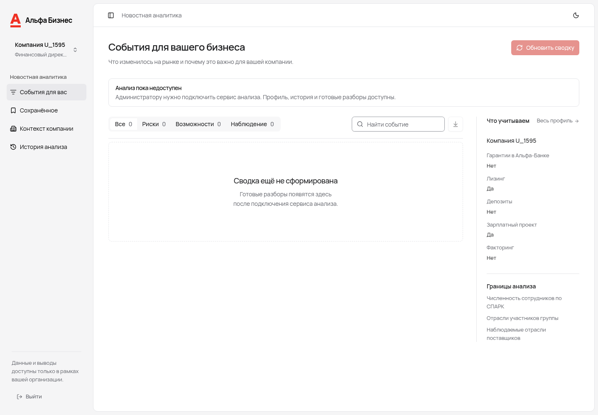
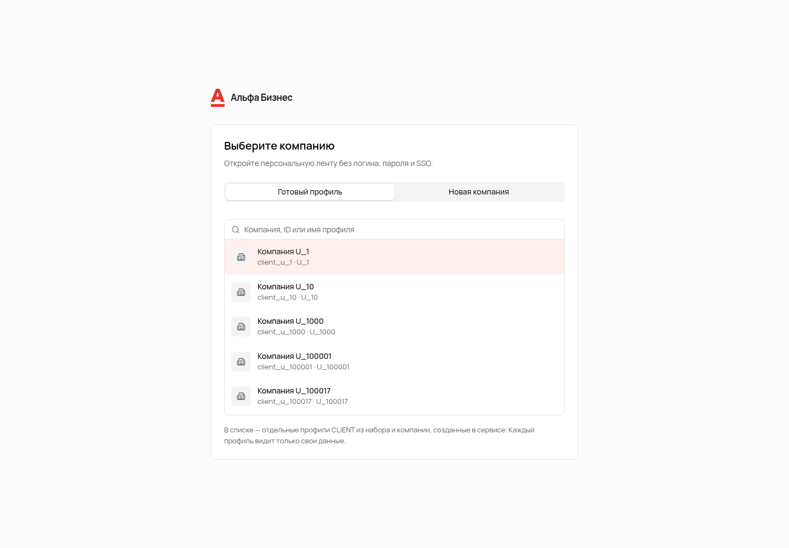
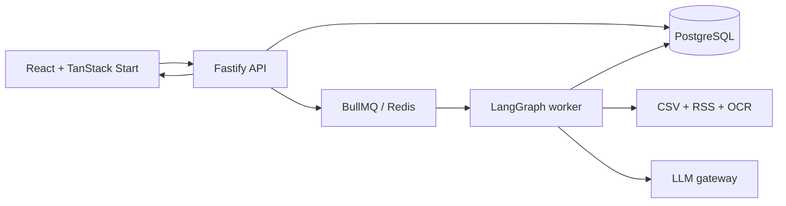
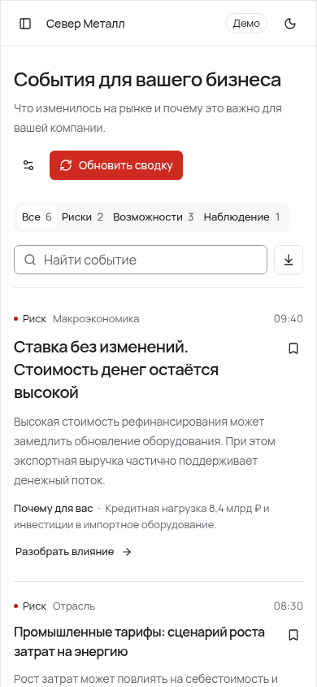
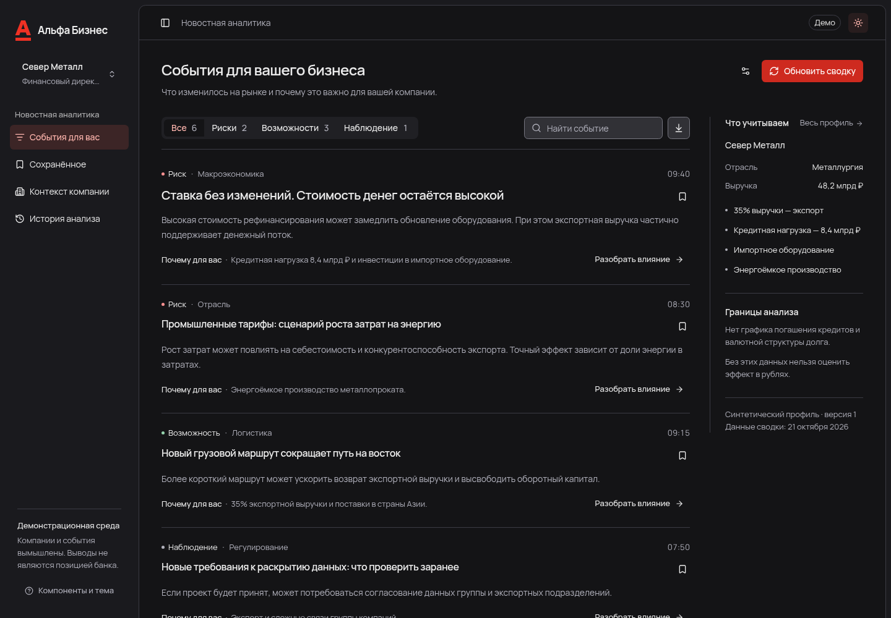

# Альфа Контекст

**Персональная новостная аналитика для бизнеса.** Сервис сопоставляет события рынка с профилем конкретной компании, объясняет влияние для CFO или CEO и показывает источники каждого вывода.

[](docs/screenshots/feed-desktop.png)

## Что увидит жюри

1. На входе найдите компанию по ID, названию или имени профиля и выберите её — пароль не нужен.
2. Переключите ракурс **CFO / CEO**: порядок и объяснения событий изменятся под задачи роли.
3. Откройте карточку: факт, влияние, риск, возможность, следующий шаг и цитаты из источников разделены.
4. Создайте новую компанию, заполните её признаки и проверьте персонализацию на собственном профиле.

Каждый из **41 968 CLIENT** в наборе получает отдельный SQL-профиль и видит только свою компанию. Сохранения, история анализа, вопросы и оценки переживают перезагрузку и не смешиваются между пользователями.

<p align="center">
  
</p>

## Почему решение полезно

| Проблема                                       | Что делает продукт                                                                  |
| ---------------------------------------------- | ----------------------------------------------------------------------------------- |
| Общая новостная лента перегружает руководителя | Ранжирует события по отрасли, региону, оборотам, продуктам банка и внешней торговле |
| Один текст не подходит разным ролям            | Формирует отдельный ракурс для CFO и CEO                                            |
| AI-выводам трудно доверять                     | Отделяет факт от интерпретации, прикладывает цитаты и явно показывает ограничения   |
| Долгий анализ теряется при закрытии страницы   | Выполняет граф в BullMQ worker, хранит checkpoints и восстанавливает состояние      |

## Как это работает



- **Frontend:** React, TanStack Start/Query, shadcn/ui, typed OpenAPI client.
- **Backend:** Fastify, Drizzle, PostgreSQL, Redis/BullMQ, strict tenant scope.
- **Agent:** LangGraph, BM25 ranking, tools over company/news/bank data, SQL checkpoints and model-call journal.
- **Data:** 85 525 company rows, 9 банковских PDF / 64 страницы и обновляемый корпус RSS-публикаций.

## Быстрый запуск

Нужны Node.js **24.19**, pnpm **11**, Docker и Python 3.

```sh
pnpm install --frozen-lockfile
pnpm --filter @alfa/agent build
python3 scripts/fetch-data.py
pnpm infra:up
pnpm db:migrate
pnpm db:seed
pnpm dev
```

Откройте [http://localhost:3000](http://localhost:3000). Backend доступен на `:3001`, OpenAPI — на [http://localhost:3001/docs](http://localhost:3001/docs). Команда `db:seed` создаёт поисковые профили для всех CLIENT; логины и пароли не требуются.

Без LLM сервис позволяет просматривать профили и уже сохранённые результаты. Для нового анализа задайте в `projects/backend/.env` значения из [.env.example](projects/backend/.env.example): `AGENT_PROVIDER=langgraph`, `LLM_BASE_URL`, `LLM_API_KEY`, разрешённую модель и подтверждённый `LLM_GATEWAY_REQUEST_CAP_RUB`. Затем перезапустите API и выполните `pnpm worker`.

Исходные ссылки на данные находятся в [брифе](specs/source/brief.pdf): [CSV, стр. 15](https://drive.google.com/drive/folders/1Ep8wWoEHTg5Q8kwrLx2j_xFyxGUEVxFq) и [материалы банка, стр. 17](https://drive.google.com/drive/folders/15xZTLF1lZ65p6o5xpNA_fRbxjoV-UlG1). Загруженные `data/raw` и `data/processed` не попадают в Git.

## Репозиторий

```text
projects/
  frontend/       интерфейс и пользовательские сценарии
  backend/        API, бизнес-модули и worker
packages/
  api-client/     OpenAPI-схема и сгенерированные типы
  agent/          граф, инструменты, ranking, ingestion и eval
specs/            продуктовые и технические спецификации
research/         рабочее пространство для новых agent/MCP-навыков
```

Frontend соблюдает направление импортов `app → pages → blocks → components → entities → shared`; backend разделён на domain/application/infrastructure/presentation. Границы и циклы проверяются автоматически.

## Проверки

```sh
pnpm typecheck
pnpm test
pnpm build
pnpm contracts:check
RUN_INTEGRATION=true TEST_DATABASE_URL=postgresql://… pnpm test:integration
```

CI проверяет OpenAPI drift, архитектурные границы, unit/integration тесты, настоящий PostgreSQL/Redis/worker, browser-сценарии и базовую доступность через axe. Fixture provider используется только в изолированных тестах; приложение не подменяет ошибки синтетической лентой.

## Материалы

- [Все спецификации](specs/README.md)
- [Аккаунты и создание компаний](specs/13-accounts-and-packages.md)
- [API и UI](specs/05-api-and-ui.md)
- [Архитектура frontend](specs/07-frontend-architecture.md)
- [Ranking и checkpoints](specs/11-ranking-and-checkpoints.md)
- [Agent, eval и запуск](packages/agent/README.md)
- [Мониторинг качества](docs/quality-monitoring.md)
- [Сторонние компоненты](THIRD_PARTY_NOTICES.md)

<p align="center">
  
  &nbsp;&nbsp;
  
</p>
