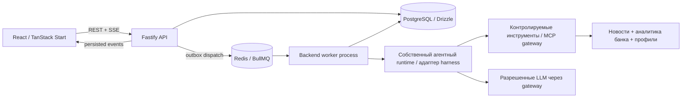

# Архитектура и стек

## Текущий шаблон

```text
Specs/                    требования и проектные решения
Projects/
  frontend/               React + TanStack Start + shadcn/ui
  backend/                Fastify + Drizzle + PostgreSQL adapter
Research/                 резерв под агентные исследования (.gitkeep)
```

| Слой | Выбор | Обоснование |
| --- | --- | --- |
| Runtime | Node.js 24, pnpm 11 | Единый TS-стек, версии зафиксированы manifest/lockfile |
| Web | React 19, TanStack Start/Router, Vite | SSR, файловые маршруты и типизированная навигация |
| UI | shadcn/ui, Tailwind CSS 4, Lucide | Полный набор исходников компонентов внутри frontend; доступность через UI-примитивы |
| API | Fastify 5, Zod | Отдельный сервис и валидация конфигурации; в будущем схем запросов |
| SQL | Drizzle ORM/Kit, pg, PostgreSQL 17 | Типизированные запросы, versioned migrations |
| Проверки | TypeScript, Vitest | Типы всех UI-компонентов и технические HTTP-контракты backend |
| SSR build | Nitro | Выход `.output/server/index.mjs`; версия закреплена, используем beta по текущей интеграции Start |

Версии пакетов в package.json и `pnpm-lock.yaml` — источник истины. Обновлять зависимости с повторной сборкой, особенно Start/Router/Vite/Nitro. Общие библиотеки пока не выделяются: два workspace-пакета без лишних абстракций.

Fastify владеет предметными данными, авторизацией и orchestration. Start отвечает за отображение и SSR; бизнес-API не дублируется в server functions фронтенда. `/api/*` проксируется Nitro на Fastify с удалением `/api` в dev и в собранном приложении. Адрес `API_PROXY_TARGET` задается при dev-запуске/сборке; production ingress, auth и TLS пока не настраиваются.

## Планируемая схема



Это будущая архитектура. В текущем compose есть PostgreSQL и dev-приложения в профиле `apps`. Redis, воркер, gateway, RAG и SSE пока не подключены.

## Два сервиса и воркер

Два проекта — frontend и backend. Воркер в дальнейшем будет отдельным процессом/контейнером из **того же backend-пакета**, а не третьим проектом. API не исполняет длительный анализ в HTTP-запросе и не запускает shell-команды из пользовательского ввода. Масштабирование API и воркеров независимое. PostgreSQL хранит результаты и состояния; Redis служит транспортом задач, не единственной копией результата.

## Запуск и инфраструктура

Сейчас `pnpm dev` запускает frontend:3000 и backend:3001. Без DATABASE_URL можно разрабатывать оболочку; `/ready` явно показывает `database: not_configured`. После копирования backend `.env.example` и `pnpm infra:up` readiness проверяет SQL через Drizzle. Это не проверка предметных миграций: таблиц еще нет.

В дальнейшем единый Docker Compose должен запускать frontend, API, worker, Postgres и Redis с healthchecks, отдельным шагом миграций, без destructive reset. Данные сохраняются в volumes; ключи не в image и не в Git. Сейчас compose поднимает dev-приложения и PostgreSQL; итоговая production-схема и worker остаются задачами реализации.
