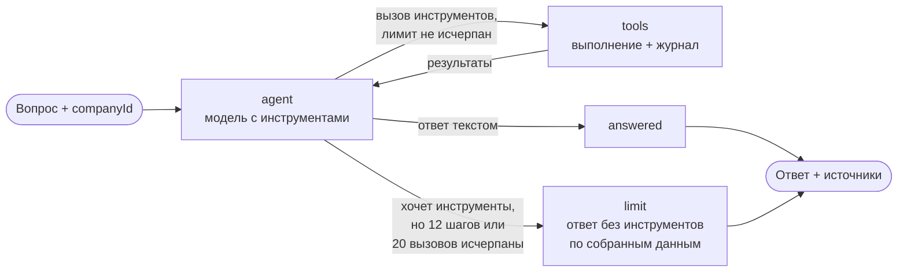
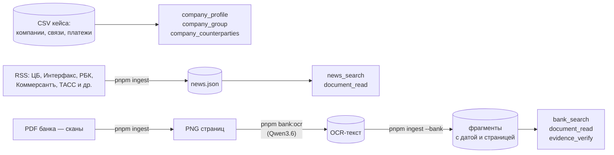

# research/agent

Этап 1:
## Как устроено



Модель сама выбирает инструменты, результаты возвращаются ей. Лимиты: 12 шагов, 20 вызовов; при исчерпании модель отвечает по собранным данным.

Ответ — 60–150 слов: прямой вывод, 2–4 причины через механизм влияния на компанию, позиция Альфа-Банка с датой, конкретное действие и сноски на источники. Под ответом печатает, где открыть каждый источник: PDF и картинку страницы или ссылку на новость. Промпты — `src/agent/prompts.ts`. Компанию задаёт сервер (`configurable.companyId`), не модель. Каждый вызов инструмента журналируется.

| Инструмент | Что возвращает |
| --- | --- |
| `company_profile` | ОКВЭД, выручка, продукты Альфа-Банка, ВЭД, регион, пропуски |
| `company_group` | Группа компаний и связи через общих физлиц |
| `company_counterparties` | Поставщики и покупатели, концентрация, отрасли |
| `news_search` | Поиск по новостям из RSS |
| `bank_search` | Поиск по материалам банка, с датой и страницей |
| `document_read` | Текст новости или страницы материала банка |
| `evidence_verify` | Есть ли цитата дословно в документе |

ОКВЭД — Общероссийский классификатор видов экономической деятельности: код отрасли компании (например, 42.99 — строительство инженерных сооружений). ВЭД — внешнеэкономическая деятельность: экспорт и импорт; в данных — признак наличия записей в базе ФТС (Федеральной таможенной службы) и страны, без направления (экспорт или импорт неизвестно).

Откуда инструменты берут данные:



Код: `src/tools` — инструменты, `src/agent` — граф, промпты и поиск источников, `src/data` — загрузка данных, `src/search` — BM25, `src/cli` — скрипты.

## Запуск

**при первой настройке**:

```sh
pnpm install
cp .env.example .env         # вписать LLM_BASE_URL и LLM_API_KEY; ID моделей уже подставлены
pnpm ingest                  # скачивает новости (RSS), вынимает из PDF картинки страниц
pnpm bank:ocr                # распознаёт картинки в текст: ~8 ₽, ~20 мин, повторный запуск продолжает с места обрыва
pnpm ingest --bank           # режет распознанный текст на фрагменты для поиска
```

**время от времени:**

```sh
pnpm ingest --news                    # свежие новости: RSS хранит только последние
pnpm bank:ocr && pnpm ingest --bank   # только если появились новые PDF банка
```

**задать вопрос агенту:**

```sh
pnpm agent <companyId> "<вопрос>" [modelId]   # 0,2–0,5 ₽;
```

**проверки:**

```sh
pnpm test                                        # после изменений в коде;
pnpm tools:demo [companyId] [запрос]             # что видят инструменты;
pnpm llm:smoke <modelId> ...                     # отвечает ли модель, вызывает ли инструменты, держит ли JSON
pnpm ocr:compare <docId>/p01.png <modelId> ...   # сравнить OCR на одной странице; ~0,15 ₽ за модель
pnpm agent:compare <modelId> ...                 # сравнить модели агента на 5 вопросах; ~4–5 ₽
```

Результаты проверок — в `results/`. Ответы агента — в `data/processed/runs/`, вне git: в них цитаты материалов банка.

## Модели

Роли: **агент — DeepSeek-V4.1-Flash, OCR — Qwen3.6**. ID берутся из `GET /models` шлюза; используются только модели из списка кейса (PDF, с. 18).

| Модель (ID) | Роль | Сильные стороны | Слабые стороны |
| --- | --- | --- | --- |
| DeepSeek-V4.1-Flash (`deepseek/deepseek-v4.1-flash`) | **Агент** | Сам завершает работу; вызывает несколько инструментов за шаг; использует контрагентов и группу компании; берёт свежий прогноз банка и отмечает, что он менялся; цитаты совпадают с текстом; дешевле Qwen на агентных прогонах | В OCR исказил число на графике (0,09 вместо −0,07); иногда приводит общую причину без опоры на данные |
| Qwen3.6 35B A3B (`qwen/qwen3.6-35b-a3b`) | **OCR** | Без ошибок в числах на 4 страницах (текст, графики, таблица, слайд); принимает изображения, хотя заявлена как текстовая | Как агент: добавляет несуществующие факты о компании, берёт устаревший прогноз банка, пропускает поиск по банку, повторяет одинаковые запросы, чаще упирается в лимит шагов |
| Qwen3-VL-30B-A3B-Instruct (`qwen/qwen3-vl-30b-a3b-instruct`) | Не используется | — | Худший OCR: потерянные минусы, перепутанный порядок значений, выброшенные легенды, **дописанный текст, которого нет на странице**; самая медленная (60–70 с на страницу) |
| Gemma 4 26B A4B (`google/gemma-4-26b-a4b-it`) | — | По кейсу: классификация и извлечение — кандидат для разметки новостей | Не проверялась |
| GLM-5.3-Flash (`z-ai/glm-5.3-flash`) | — | По кейсу: сложный анализ — кандидат для проверки ответов | Не проверялась |
| Kimi-K2.6 (`moonshotai/kimi-k2.6`) | — | По кейсу: текстовая аналитика | Не проверялась |

Сравнения: OCR — [results/ocr-compare-2026-10-21/SUMMARY.md](results/ocr-compare-2026-10-21/SUMMARY.md), базовые возможности — [results/llm-smoke-2026-10-21.md](results/llm-smoke-2026-10-21.md), агент — `pnpm agent:compare`.

`LLM_REASONING_EFFORT=none`: Qwen3.6 и DeepSeek по умолчанию «думают», с рассуждениями ответ пустой, а вызов дороже в 200–300 раз. Стоимость каждого вызова приходит в `usage.cost`; лимит ключа — 500 ₽ в сутки, сброс в 03:00 МСК.

## Данные:

- PDF банка — сканы, текст получен OCR. Из графиков извлекаются только подписанные значения.
- Прогнозы банка менялись: ставка на конец 2026 г. — 13,5% в июле, 14,0% с 11 сентября.
- Отчёт о стали 2021 г. не из списка кейса, помечен как устаревший.
- Компании: 85 525 строк, 85 514 ID (есть дубли); выручке > 15 млрд соответствуют 115 компаний (если выручка в рублях).
- Платежи: есть самоплатежи (исключаются); у крупных компаний большая часть контрагентов без профиля.
- Продукты в профиле — только Альфа-Банка.
- RSS даёт в основном заголовок и лид, полный текст только у РБК.
