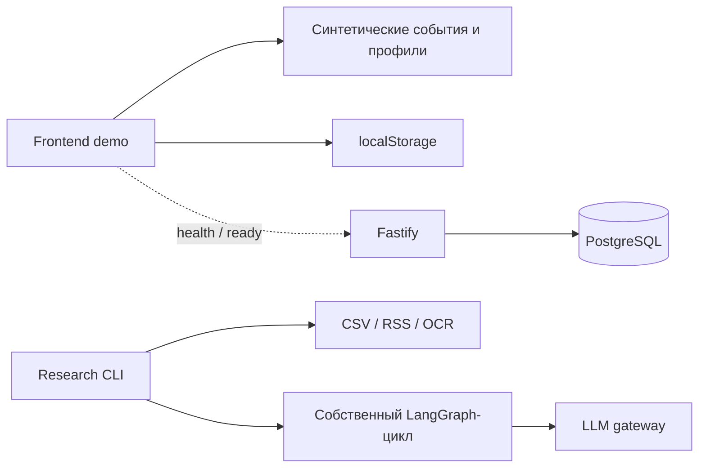
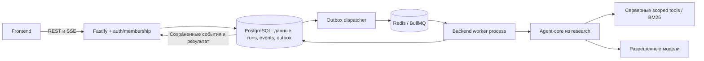

# Архитектура: текущее состояние и целевой контур

```text
projects/frontend/       React / TanStack Start / shadcn/ui
projects/backend/        Fastify / Drizzle / PostgreSQL
research/agent/          CLI данных, инструментов и агента
specs/                   требования и план реализации
docs/screenshots/        снимки действующего frontend
```

Версии определены manifests и lockfile: Node 24.19.0, pnpm 11.25.0, React 19, Tailwind 4, Vite/Nitro. Manrope с кириллицей обслуживается самим приложением. Frontend использует существующие локальные shadcn-компоненты, преимущественно Radix; combobox использует Base UI.

## Сейчас



Пунктир — техническая проверка, не предметная интеграция. Frontend не вызывает research и платные модели; backend не импортирует CLI/граф.

## Целевая схема



- **Frontend:** `app → pages → blocks → components → entities → shared`. Start отвечает за routing/SSR/UI. Логика доступа, инструменты и ключи — на сервере. [Подробности](07-frontend-architecture.md).
- **API:** проверяет session, membership, входы и idempotency; создает долговечный run и быстро возвращает 202. Аналитический `perspective=cfo|ceo` не повышает `userRole`.
- **Worker:** отдельный entrypoint/контейнер того же backend-пакета, независимый от HTTP. Run scope повторно проверяется перед запуском.
- **Research → core:** нельзя вызывать top-level CLI через shell. Нужна import-safe библиотека с exports/build/types: загрузка контекста, tools, graph, валидатор результата, adapters хранения/бюджета. CLI остается потребителем. Текущий research-пакет production export contract не предоставляет.
- **Хранение:** SQL — источник истины для прав, runs, результатов и events. Versioned BM25-корпус загружается worker один раз на версию. Redis — транспорт, не единственная копия ответа. PDF/страницы доступны только через auth endpoint, не через filesystem path.

## Окружения

`pnpm dev`: frontend:3000, backend:3001. Для browser demo backend не нужен. Nitro `/api/**` снимает `/api`; target задается `API_PROXY_TARGET` при dev/сборке.

Compose profile `apps` запускает dev-приложения и PostgreSQL; worker/Redis не добавлены. `/ready` с DATABASE_URL проверяет SQL, без URL честно сообщает `not_configured`. Это не проверка предметного продукта.

Research имеет отдельный `.env` и dataset directory; офлайн-тесты не требуют gateway. В production еще нужны ingress/TLS, session/auth, CSRF policy при cookie-auth, migrations job, worker/Redis, retention, backup и observability. Dockerfile сейчас — среда разработки.
