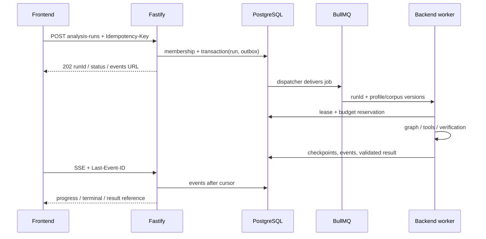

# Агентный runtime: research и backend

> Обновление backend: [реализованный контур и ограничения MVP](10-backend-implementation.md). Ниже сохранены исходный аудит и целевые требования; наличие пункта в roadmap не означает отсутствие его MVP-реализации.

## Что реализовано

`buildAgentGraph`: agent → tools → agent, выход answered или limit. Модель выбирает инструменты; собственные tools, prompt, правила и лимиты реализует команда. LangGraph — orchestration-библиотека. Готовый автономный OpenCode не используется; оснований заменять им текущую логику не найдено (PDF, с. 7, 18).

Семь tools: company_profile, company_group, company_counterparties, news_search, bank_search, document_read, evidence_verify. Company ID приходит из серверного configurable.companyId.

Лимиты: 12 agent-node вызовов, 20 запрошенных tool calls. Batch сверх лимита не исполняется; затем модель делает дополнительный финальный вызов без tools. Этот вызов тоже стоит денег, хотя счетчик steps его не учитывает.

Prompt требует цитирования и самопроверки, но graph **не принуждает** выполнить evidence_verify и не валидирует финальный structured DTO. Checkpointer не подключен: state в памяти; CLI сохраняет только итоговый JSON. Текст и эвристический locateSources — исследовательский выход, не безопасный API-ответ.

## Зачем отдельный worker

Для длительных вопросов, retries, отмены и общего бюджета нужен BullMQ/Redis и отдельный worker process в backend-пакете. Не запускать CLI shell-строкой и не ждать всю модель в HTTP-запросе. Два прикладных проекта сохраняются.

RunContext: runId, userId, разрешенный companyId, perspective, corpus/profile/prompt versions, budget reservation, deadline и AbortSignal. Worker повторяет membership/CLIENT-проверку. CLI-проверка сама по себе не защищает HTTP.

Состояния: queued → running → completed|partial|failed|cancelled, при отмене возможен cancelling. `stopReason=limit` не означает успех: при достаточной проверке — partial, иначе failed/insufficient evidence. Предыдущий успешный insight хранится отдельно от нового run.

## Надежность и бюджет

1. SQL outbox, детерминированные job IDs, idempotency keys; доставка at least once, не exactly once.
2. Run/step/toolCall IDs, lease и durable checkpoints; повтор не должен публиковать дубликат или повторять завершенные tools вслепую.
3. Retry только transient timeout/429/5xx с backoff/jitter. Учитывать встроенные maxRetries=2 gateway-клиента; не перемножать внешние retries без лимита. Validation/access/budget errors не повторять автоматически.
4. Общая атомарная квота всех worker: резерв до вызова, сверка usage после. Отсутствие usage.cost — неизвестная стоимость, **не ноль**. Research costOf сейчас возвращает 0 при отсутствии поля: доработать перед production.
5. Бюджет 500 ₽/день. В README research указан сброс 03:00 МСК; подтвердить gateway-контрактом. Валюта usage.cost и конвертация должны быть явными до сравнения с рублевым бюджетом.
6. Отмена — SQL-флаг + AbortSignal модели/tools, проверка перед каждым шагом и публикацией. Удаление job не отменяет сетевой запрос. Не публиковать отмененный результат.
7. Graceful shutdown прекращает прием jobs и сохраняет checkpoint. Redis требует persistence и подходящей BullMQ memory policy.

Стартовые caps для нагрузочного теста: concurrency=2, 12 steps плюс финализация, 20 tools, 120 секунд/model call, 10 минут/run. Это проектные значения, не реализованный SLA. OCR — отдельный resumable job по hash страницы, не часть каждого вопроса.

## Результат и tools boundary

Публиковать валидированный JSON: summary, claims, позиция банка, риски/возможности, действия, citations и limitations. Разделять fact/bank_position/ai_inference. Верифицировать документ/цитату и права; не выдавать hidden chain-of-thought.

Локальные типизированные tools сейчас достаточны; MCP не используется. При необходимости MCP — auth gateway с теми же scope и schemas, только нужные read-only инструменты. Никаких shell, произвольного SQL/URL, Docker socket или записи в банк.

Документы и tool results — недоверенные данные, не системные инструкции. Политика доступа действует вне модели. Fetcher требует HTTPS allowlist, redirect checks, запрет private/link-local addresses, timeout и потоковый hard limit. Research проверяет host/redirect, но размер тела только после чтения: этого мало для production.

Публичный trace содержит действия, outcomes и источники без ключей, private paths и чувствительных raw args. Аудит research нельзя напрямую сериализовать браузеру. Конкретные адаптеры и пробелы — [08](08-research-integration.md).
